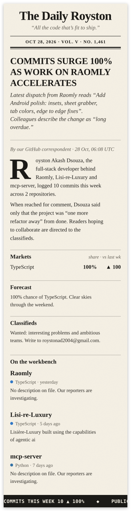

  <picture>
  <source media="(min-width: 601px)" srcset="assets/front-page.svg" />
  
</picture>

  <i>This front page is reprinted every morning by a GitHub Action from my real commits. <a href="scripts/build-paper.mjs">How it's made →</a></i>

 

  <b>Correspondence</b>
   
  <a href="https://roystondsouzav3.vercel.app">Portfolio</a>
  &nbsp;·&nbsp;
  <a href="https://linkedin.com/in/royston-akash-dsouza">LinkedIn</a>
  &nbsp;·&nbsp;
  <a href="mailto:roystonad2004@gmail.com">roystonad2004@gmail.com</a>

